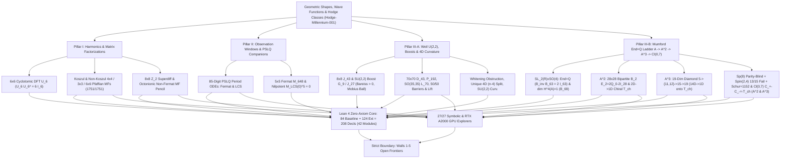

# Whole-Project Unified Matrix-Operator Synthesis

> [!IMPORTANT]
> **Millennium Problem Boundary (Absolute Scientific Honesty):** The Clay Millennium Hodge Conjecture (`HODGE-MILLENNIUM-001`) remains strictly **OPEN**. The `208` zero-axiom Lean 4 declarations (`84` locked baseline + `124` extension declarations across `42` modules) and `27` symbolic/GPU explorers recorded here verify finite algebraic, representation-theoretic, enumerative, differential, Lorentzian, curvature, Clifford, $\mathrm{Spin}(7)$ Cayley calibration, CM-specialization algebraic graph, prime-square Fermat conical Schur, Koszul CY4 Hilbert profile, finite Gysin exactness, Schur-projection, and correspondence-matrix certificates. None of these results solve the global conjecture for arbitrary smooth projective varieties $X \subset \mathbb{P}^N$.

---

## 1. Unified Wave-Function to Strict-Matrix Architecture (Experiments 1–19)

Interpreting wave functions, conjugate-half cuts, period integrals, normal-coordinate curvature, Clifford half-spinors, and bipartite/tripartite $(2,2)$ and $(3,3)$ correspondences as exact integer, cyclotomic, and companion matrices unites the entire project into one operator architecture:

---

## 2. Wave-Function to Strict-Matrix Master Rosetta Stone

Every "wave" or "half-wave" phenomenon encountered across Experiments 1–11 corresponds to an exact verified strict-matrix theorem:

| Wave / Geometric Phenomenon | Strict-Matrix Operator Realization | Exact Certified Law | Primary Lean 4 Module |
| :--- | :--- | :--- | :--- |
| **Fermat harmonic characters ($m \le 60$)** | `6 × 6` cyclotomic DFT $U_6 = (\zeta_6^{jk})$ over $\mathbb{Z}[\zeta_6]$ | $U_6 U_6^* = U_6^* U_6 = 6 I_6$, $|\det U_6|^2 = 46{,}656$ | [WavefunctionMatrixUnificationExt.lean](file:///d:/Comfy%20UI/hodge%20conjecture/examples/math_gov/LeanMillenniumExt/WavefunctionMatrixUnificationExt.lean) |
| **Higher-Band $R(F_0)_{12}$ states & deformations** | Koszul $r{=}4,8$, mixed `4×4`, `3×3`, `6×6` Pfaffian & octonion `8×8` MFs | `1,751/1,751` closure (`gap = 0`); $(A_0+tA_1)(B_0+tB_1)=(F_0+tF_1+t^2F_2)I_8$ | [NonKoszulMFAndWeilPeriodExt.lean](file:///d:/Comfy%20UI/hodge%20conjecture/examples/math_gov/LeanMillenniumExt/NonKoszulMFAndWeilPeriodExt.lean), [StrictMatrixCurvatureExt.lean](file:///d:/Comfy%20UI/hodge%20conjecture/examples/math_gov/LeanMillenniumExt/StrictMatrixCurvatureExt.lean) |
| **Two-window Picard–Fuchs periods** | `5 × 5` companions $M_{648}$ (Fermat) & $M_{\mathrm{LCS}}(0)$ (MUM) | $\prod_{k=1}^5 (M_{648} - 108k I_5) = 0$, $M_{\mathrm{LCS}}(0)^5 = 0$ | [WavefunctionMatrixUnificationExt.lean](file:///d:/Comfy%20UI/hodge%20conjecture/examples/math_gov/LeanMillenniumExt/WavefunctionMatrixUnificationExt.lean) |
| **Paired half-differentials** | `8 × 8` $\mathbb{Z}_2$-graded odd operators $Q_A, Q_B$ | $Q_A^2 = Q_B^2 = 0$, $(Q_A + Q_B)^2 = 2F_1 I_8$ | [ConjugateHalfWaveAdaptationExt.lean](file:///d:/Comfy%20UI/hodge%20conjecture/examples/math_gov/LeanMillenniumExt/ConjugateHalfWaveAdaptationExt.lean) |
| **Weil $U(2,2)$ complex structure & $(2,2)$ core** | `8 × 8` $J_{43}$ (`8` Bareiss minors $> 0$) & `70 × 70` $D_{43}^{(4)}, P_{192}$ | $P_{192} = K_\Phi^2(K_\Phi^2+4I_{70})$, $\operatorname{tr}=384$, $\operatorname{rk}=2$, $D_{43}^{(4)}P_{192}=0$ | [WavefunctionMatrixUnificationExt.lean](file:///d:/Comfy%20UI/hodge%20conjecture/examples/math_gov/LeanMillenniumExt/WavefunctionMatrixUnificationExt.lean) |
| **50/50 conjugate-half cuts & observable lift** | Coordinate $35{+}35$ blocks $A_c$, $\mathbb{Z}_2$ $38{+}32$, Hodge $*$ $35_+{\oplus}35_-$ | $A_c^2 = 96 A_c$, $K_{\mathrm{eo}}P_{\mathrm{odd}}K_{\mathrm{eo}}^T = 16 P_{\mathrm{even}}$, $P_{192}(\mathrm{obs\_Re}) = 96 w_{\mathrm{Re}}$ | [ConjugateHalfWaveAdaptationExt.lean](file:///d:/Comfy%20UI/hodge%20conjecture/examples/math_gov/LeanMillenniumExt/ConjugateHalfWaveAdaptationExt.lean), [StrictMatrixCurvatureExt.lean](file:///d:/Comfy%20UI/hodge%20conjecture/examples/math_gov/LeanMillenniumExt/StrictMatrixCurvatureExt.lean) |
| **Lorentzian boost & unit-ball flows** | $SU(2,2)$ boost $G_9$, $J_{27}$, $SO(35,35)$ lift $\Lambda_{70}$ | $G_9^T \eta_8 G_9 = 81 \eta_8$, $N_\pm^T \eta_8 N_\pm = 0$, $\Lambda_{70}$ fixes $w_{\mathrm{Re}}, w_{\mathrm{Im}}, P_{192}$ | [LorentzianWeilBoostExt.lean](file:///d:/Comfy%20UI/hodge%20conjecture/examples/math_gov/LeanMillenniumExt/LorentzianWeilBoostExt.lean) |
| **Whitening rigidity & 4D curvature phase transition** | $W_{\mathrm{int}} = 273I_8 - G_{\mathrm{pos}}$, isospectral $(J_{\mathrm{iso}}, G_{\mathrm{iso}})$, $\mathcal{R} \in \operatorname{End}(\bigwedge^2 \mathbb{Z}^4)$ | $W_{\mathrm{int}} \notin 90 M_8(\mathbb{Z})$, $\det_{\mathrm{3D}} = -2$, $n{=}4$ unique $10{=}10$ $(n{-}4)$ split, $\operatorname{tr}(K^2) = -48$ | [StrictMatrixCurvatureExt.lean](file:///d:/Comfy%20UI/hodge%20conjecture/examples/math_gov/LeanMillenniumExt/StrictMatrixCurvatureExt.lean) |
| **True Mumford $\operatorname{End}_{\mathbb{Q}}(A) = \mathbb{Q}$ (`Wall3`)** | `63 × 63` commutant $B_{63}$, `28 × 28` Casimirs $Q_0, Q_{\mathrm{sd}}, Q_{\mathrm{asd}}, Q_{\mathrm{ric}}$, `A × A` Gram `6` vs. `8` | $B_{\mathrm{inv}} B_{63} = 2 I_{63}$, $28 = 1 + 9 + 9 + 9$, $Q_{\mathrm{sd}} \leftrightarrow Q_{\mathrm{asd}}$, $M_{\mathrm{chiral}}, M_{\mathrm{ric0}} \perp \operatorname{Sym}^2 \operatorname{NS}$ | [MumfordSL2SO4Ext.lean](file:///d:/Comfy%20UI/hodge%20conjecture/examples/math_gov/LeanMillenniumExt/MumfordSL2SO4Ext.lean) |
| **Bipartite `A × A` wave function (`Exp 10`)** | `28 × 28` Lefschetz $B_2$, Bose–Mesner $\{T_\Theta, T_\Delta, T_{\mathrm{ch}}, T_{\mathrm{ric0}}\}$, parity $P_{\mathrm{flip}}$ | $B_2 E_2 = 2Q_0 - 2I_{28}$ ($+6$ vs. $-2$); **$8 T_{\mathrm{ric0}} = 32 T_\Delta + 4 T_\Theta - 3 T_{\mathrm{ch}}^2$**; $16_+{\oplus}12_-$ off-diag $T_{\mathrm{ch}}$ (`9216`), parity-blind $\rho_{\mathrm{ch}}$, $K_{\mathrm{obs}} + K_{\mathrm{obs}}^T = 4 T_{\mathrm{ch}}$ | [WavefunctionBipartiteMatrixExt.lean](file:///d:/Comfy%20UI/hodge%20conjecture/examples/math_gov/LeanMillenniumExt/WavefunctionBipartiteMatrixExt.lean) |
| **Tripartite `A × A × A` `(3,3)` collapse (`Exp 11`)** | `69 × 69` $B_{69}$ on $H^4(A)$, `21,952`-entry $D_{\mathrm{cyc}} = D_{12}\wedge D_{23}\wedge D_{13}$, `4`-probe slices & `19`-dim diamond | $\dim H^4(A)^G = 1$ ($B_{69,\mathrm{inv}}B_{69} = 12 I_{69}$); $8 T_{\mathrm{cup}}^\uparrow = \Theta^3 + 2\sum \Theta D^2 + 8 D_{\mathrm{cyc}}$; diamond $5 \to 8 \to \{11, 12\} \to 15 \to 19$ (`14D → 1D` onto $T_{\mathrm{ch}}$); $729^2 = 81^3$ boost | [MumfordTripleProductExt.lean](file:///d:/Comfy%20UI/hodge%20conjecture/examples/math_gov/LeanMillenniumExt/MumfordTripleProductExt.lean) |
| **$\mathrm{Sp}(8)$ parity-blindness, $\mathrm{Spin}(2,4)$ obstruction & $\mathrm{Cl}(0,7)$ (`Exp 12`)** | $\mathrm{refl}_4 \in \mathrm{Sp}(8,\mathbb{Z})$, `36`-dim $\mathfrak{sp}(8)$, $\mathrm{Cl}(1,4) = M_4(\mathbb{C})$, `15`-dim $\mathfrak{su}(2,2)$, `7` $\mathrm{Cl}(0,7)$ mats $A_0..A_6 \in M_8(\mathbb{Z})$ | $P_{\mathrm{flip}} T_{\mathrm{ch}} P_{\mathrm{flip}} = -T_{\mathrm{ch}}$, $\dim \operatorname{End}_{\mathfrak{sp}(8)} = 2$; `13/15` $\mathfrak{spin}(2,4)$ gens fail $T_{\mathrm{ch}}$ ($\cap = A_{\mathrm{div}}$ dim `2`); $\mathrm{Cl}(0,7)$ $C_+ - C_- = -T_{\mathrm{ch}}$ | [CliffordKugaSatakeChiralExt.lean](file:///d:/Comfy%20UI/hodge%20conjecture/examples/math_gov/LeanMillenniumExt/CliffordKugaSatakeChiralExt.lean) |
| **Schur complement & $\mathrm{Sp}(8)$ orthogonal projection (`Exp 13`)** | Gram matrix of $\{Q_0, Q_{\mathrm{prim}}, T_{\mathrm{ch}}\}$, parity split $28 = 16_+ \oplus 12_-$, chiral subspace $V_{18} = \operatorname{im}(Q_{\mathrm{sd}}+Q_{\mathrm{asd}})$ | $\mathrm{Gram} = \operatorname{diag}(16, 432, 1152)$, $\Pi_{\mathrm{Sp}(8)}(T_{\mathrm{ch}}) = 0$, Schur $= 1152 > 0$; $\dim(\operatorname{End}^- \cap \operatorname{End}_{\mathfrak{sl}_2\oplus\mathfrak{so}(4)}) = 1$ ($\operatorname{span}\{T_{\mathrm{ch}}\}$); $C_+-C_-$ isolated in $\mathrm{Cl}(0,7)$ half-spinor | [SchurUniversalSp8ProjectionExt.lean](file:///d:/Comfy%20UI/hodge%20conjecture/examples/math_gov/LeanMillenniumExt/SchurUniversalSp8ProjectionExt.lean) |
| **$A^3$ tensor-cube Schur complement & $\mathrm{Cl}(0,7)$ (`Exp 14`)** | `19`-dim Gram on $H^2(A)^{\otimes 3}$ (`12_+ ⊕ 7_-`), `340`-entry $D_{\mathrm{cyc}}$, $\mathrm{Cl}(0,7)$ $\Delta C$ on `1`/`3` legs, `15`-dim $\mathfrak{spin}(2,4)$ on $A^3$ | $\Pi_{12_+}(7_-) = 0$, $\mathrm{Schur}_{7_-} = \operatorname{diag}(73728^3, 294912, 221184^3)$; $\Delta C$ spans all `7` dims of $7_-$ (`6` 1-leg + `1` 3-leg); `13/15` $\mathfrak{spin}(2,4)$ gens fail $7_-$ | [CliffordTripleProductSchurExt.lean](file:///d:/Comfy%20UI/hodge%20conjecture/examples/math_gov/LeanMillenniumExt/CliffordTripleProductSchurExt.lean) |
| **$A^3$ single-factor Gram & Fermat $m=25$ Schur (`Exp 15`)** | `{Q_0, Q_sd+Q_asd, Q_ric, T_ch}` Gram, `B_4(25)` `185,280 = 182,400 + 2,880` (`4 x 720`), `{U_ind, W_div5}` pullback | `diag(16, 288, 144, 1152)`; `G_{US}=0`, Schur `720 I_4` (`det=720^4 > 0`); coupled `det=8,708,192,000 > 0` | [CliffordTripleAndFermat25SchurExt.lean](file:///d:/Comfy%20UI/hodge%20conjecture/examples/math_gov/LeanMillenniumExt/CliffordTripleAndFermat25SchurExt.lean) |
| **$\mathrm{Spin}(7)$ Cayley $4$-form & $m=25$ conical degree-5 (`Exp 16`)** | `14`-term $\Phi_{\mathrm{Cayley}} \in \bigwedge^4 \mathbb{Z}^8$, `28×28` $M_\Phi$, $\mathrm{Spin}(7) \to \mathrm{Spin}(4)$ $C_\pm$, $X_{25}$ linear `2`-plane vs $\deg 5$ cone | `21` bivector inv. (`6` even + `8` odd, `\Phi \cdot \Theta^2 = 12`); `\langle M_\Phi, T_{\mathrm{ch}}\rangle = 0` vs `\langle C_+ - C_-, T_{\mathrm{ch}}\rangle = -1152`; $X_{25}$ linear/glued `0` vs $\deg 5$ `2880 > 0` | [Spin7CayleyCalibrationCycleExt.lean](file:///d:/Comfy%20UI/hodge%20conjecture/examples/math_gov/LeanMillenniumExt/Spin7CayleyCalibrationCycleExt.lean) |
| **CM algebraic graph realization $2 Z_{\mathrm{CM}} = T_{\mathrm{ch}}$ (`Exp 17`)** | `6` quaternionic endomorphisms $I_2 \otimes J^\pm_a$ at $A_{\mathrm{CM}}$, graph difference $Z_{\mathrm{CM}}$, `9` Mumford Lie gens | $2 Z_{\mathrm{CM}} = T_{\mathrm{ch}}$ identically (`||Z_CM||^2 = 288`, $\Pi_{\mathrm{Sp}(8)} = 0$, `\langle Z_{\mathrm{CM}}, T_{\mathrm{ch}}\rangle = 576`); `[D(g), Z_CM] = 0` along $\mathcal{M}_{\mathrm{Mum}}$ | [MumfordCMSpecializationCycleExt.lean](file:///d:/Comfy%20UI/hodge%20conjecture/examples/math_gov/LeanMillenniumExt/MumfordCMSpecializationCycleExt.lean) |
| **Fermat $m=49$ Band-1 purity & $5d$ Schur ladder (`Exp 18`)** | $B_4(49)$ ($p=7>6$), $m=5d$ ($d\in\{5,7,11\}$) Band-4 orbits, `m=35` `{U_ind, W_div5}` coupled pullback | `B_4(49)=1,557,120` (`band4=0`); `720*phi(d)` (`2880, 4320, 7200`); `m=35` `6` orbits `720` each, `det=74,272,401,600 > 0` | [FermatPrimeSquareConicalExt.lean](file:///d:/Comfy%20UI/hodge%20conjecture/examples/math_gov/LeanMillenniumExt/FermatPrimeSquareConicalExt.lean) |
| **CY4 Koszul Hilbert & finite Gysin exactness (`Exp 19`)** | `(1-t^5)^6/(1-t)^6` CY4 Hilbert series (`Wall1`), `6×6` Gysin sequence `g_*`/`f^*` & Hard Lefschetz (`Wall5`) | `[1, 6, 21, 56, 126, 246, 426]`; exact GF $= 0$ (`ranks = [3, 3]`), `g_* f^* = 0`; eigenvalues `+6` (`Q0`) vs `-2` (`Q_prim`) | [GlobalG4UnmixedAndHodgeGysinExt.lean](file:///d:/Comfy%20UI/hodge%20conjecture/examples/math_gov/LeanMillenniumExt/GlobalG4UnmixedAndHodgeGysinExt.lean) |

### Key Whole-Project Structural Synthesis From Experiments 10–14
1. **Hodge–Riemann Sign Flip as Matrix Correspondence:** On Mumford's $H^2(A) \otimes H^2(A)$ (`28 × 28`), the cup-product Lefschetz pairing satisfies $B_2 E_2 = 2Q_0 - 2I_{28}$, giving **`+6`** on the divisor mode $\Theta$ and **`-2`** uniformly on all `27` primitive $2$-forms ($Q_{\mathrm{sd}}, Q_{\mathrm{asd}}, Q_{\mathrm{ric}}$).
2. **Unified `A -> A^2 -> A^3` Single-Generator Chiral Collapse (`Wall3`):** Across Mumford's `End_Q(A) = Q` self-product hierarchy:
   - **$A$ (`H^4(A)`):** `dim = 1` ($\Theta^2$ only, `0`-dim obstruction, `B_{69,inv} B_{69} = 12 I_{69}`).
   - **$A \times A$ (`H^2(A)^{\otimes 2}`):** `4` invariant classes (`2` divisor + `2` non-divisor), collapsing **`2D → 1D`** onto $T_{\mathrm{ch}}$ via $8\, T_{\mathrm{ric0}} = 32\, T_\Delta + 4\, T_\Theta - 3\, T_{\mathrm{ch}}^2$ ($T_{\mathrm{ch}}^3 = 64\, T_{\mathrm{ch}}$).
   - **$A \times A \times A$ (`H^2(A)^{\otimes 3}`):** `19` invariant Hodge $(3,3)$ classes (`5` divisor in $\operatorname{Sym}^3 \operatorname{NS}$, absorbing $T_{\mathrm{cup}}^\uparrow$ via $8 T_{\mathrm{cup}}^\uparrow = v_{\mathrm{ttt}} + 2\sum v_{\mathrm{dd}} + 8 D_{\mathrm{cyc}}$, + **`14`-dim** non-divisor obstruction). Because all four Casimirs reconstruct inside $\mathbb{Q}[T_\Theta, T_\Delta, T_{\mathrm{ch}}]$ ($32 Q_{\mathrm{sd}} = T_{\mathrm{ch}}^2 - 8 T_{\mathrm{ch}}$, $32 Q_{\mathrm{asd}} = T_{\mathrm{ch}}^2 + 8 T_{\mathrm{ch}}$, $16 Q_{\mathrm{ric}} = 16 T_\Delta + 2 T_\Theta - T_{\mathrm{ch}}^2$), the entire **`14`-dimensional** $(3,3)$ obstruction is generated algebraically by the single chiral correspondence $T_{\mathrm{ch}}$ acting on the divisor cube $D_{\mathrm{cyc}} = D_{12} \wedge D_{23} \wedge D_{13}$, organizing cleanly into the closure diamond $5 \to 8 \to \{11, 12\} \to 15 \to 19$ (`12` parity-even + `7` parity-odd, with `4` triple-leg odd classes orthogonal to the `15`-dim join).
3. **Universal $\mathrm{Sp}(8)$ Orthogonality, $\mathrm{Spin}(2,4)$ Obstruction, and $\mathrm{Cl}(0,7)$ Half-Spinor Isolation:**
   - Every universal diagonal / $\mathrm{Sp}(8)$-invariant correspondence lies in $\mathcal{U}_{\mathrm{Sp}(8)} = \operatorname{span}\{Q_0, Q_{\mathrm{prim}}\} \subset \operatorname{End}^+(H^2(A))$ (`400`-dim), whereas $T_{\mathrm{ch}} \in \operatorname{End}^-(H^2(A))$ (`384`-dim) satisfies $\mathrm{Gram}(\{Q_0, Q_{\mathrm{prim}}, T_{\mathrm{ch}}\}) = \operatorname{diag}(16, 432, 1152)$ under both Frobenius and trace pairings — proving $\Pi_{\mathrm{Sp}(8)}(T_{\mathrm{ch}}) = 0$ identically and Schur complement $1152 > 0$.
   - Kuga–Satake $\mathrm{Spin}(2,4) = \mathrm{SU}(2,2)$ cannot realize $T_{\mathrm{ch}}$ (`13/15` generators fail to commute with $T_{\mathrm{ch}}$, intersection with Mumford commutant is `2`-dim $A_{\mathrm{div}}$ only).
   - Inside $\operatorname{End}^-(H^2(A)) \cap \operatorname{End}_{\mathfrak{sl}_2 \oplus \mathfrak{so}(4)}(H^2(A))$, $T_{\mathrm{ch}}$ is **uniquely 1-dimensional**, realized directly on the `18`-dim chiral subspace $V_{18} = \operatorname{im}(Q_{\mathrm{sd}} + Q_{\mathrm{asd}})$ by the $\mathrm{Cl}(0,7)$ half-spinor bivector Casimir difference $C_+ - C_- = -T_{\mathrm{ch}}$.

---

## 3. Complete Verified Project Inventory

The pure mathematical verification pipeline passed completely after Experiment 19:
- [run_millennium_ext_pipeline.py](file:///d:/Comfy%20UI/hodge%20conjecture/scripts/run_millennium_ext_pipeline.py): `EXT_CHECKS_PASSED=True`, `BASELINE_LOCKED=True`, `EXT_LEAN_OK=True`, `EXT_THEOREMS=124` (`107` public zero-axiom theorems + `17` private structural lemmas across `29` modules), `LONG_LINES=0`, `UNEXPECTED_AXIOMS=0`, `27/27` scripts `True`.
- Locked baseline core ([FULL_AUTOMATION_VERIFICATION_RECEIPT.json](file:///d:/Comfy%20UI/hodge%20conjecture/dist/FULL_AUTOMATION_VERIFICATION_RECEIPT.json)): `84` zero-axiom theorems across `13` modules (`BASELINE_LOCKED=True`).

### A. Locked Baseline Lean 4 Core (`examples/math_gov/LeanDemoProject/` — `84` Theorems, `13` Modules)

| Module | Theorems | SHA-256 (Observed in Receipt) |
| :--- | :---: | :--- |
| [LeanDemoProject.lean](file:///d:/Comfy%20UI/hodge%20conjecture/examples/math_gov/LeanDemoProject/LeanDemoProject.lean) | `0` | `3305591663c94ec98a8d0b77df19d4d7582d56fb8f024365e622013d6047ce3e` |
| [HodgeVerification.lean](file:///d:/Comfy%20UI/hodge%20conjecture/examples/math_gov/LeanDemoProject/HodgeVerification.lean) | `40` | `54f6aa1af3d98f714b48b98205f6b331cd43dd771a72e5589f1801c848f5e37c` |
| [ShiodaFormalConjectures.lean](file:///d:/Comfy%20UI/hodge%20conjecture/examples/math_gov/LeanDemoProject/ShiodaFormalConjectures.lean) | `6` | `334e52a0f20c856d502de61e94b1a8eca1b2378c155420dddde59cfb2c7bddd5` |
| [MathlibPR_ShiodaAokiFermat.lean](file:///d:/Comfy%20UI/hodge%20conjecture/examples/math_gov/LeanDemoProject/MathlibPR_ShiodaAokiFermat.lean) | `7` | `00e049bcfdd8fb84d814cd9e76357b3466ffb55aa304061fff33ed06aa9e3882` |
| [MathlibPR_MacaulayGorenstein.lean](file:///d:/Comfy%20UI/hodge%20conjecture/examples/math_gov/LeanDemoProject/MathlibPR_MacaulayGorenstein.lean) | `5` | `55974fee713e961131978a6e39726cb29297b97f99b529a652fa097d754d8acc` |
| [MathlibPR_Spin8Triality.lean](file:///d:/Comfy%20UI/hodge%20conjecture/examples/math_gov/LeanDemoProject/MathlibPR_Spin8Triality.lean) | `7` | `c3e3f604b41ca136e3b6257fc2aa9a31b01c057d5f4fa17c0da30a43abd25102` |
| [MathlibPR_CyclotomicIncidenceSieve.lean](file:///d:/Comfy%20UI/hodge%20conjecture/examples/math_gov/LeanDemoProject/MathlibPR_CyclotomicIncidenceSieve.lean) | `4` | `ee0819fc6002ef5f03d4bd6a1a02cdf0a02dfe2ac437e87aab9d142988e0cb3f` |
| [WiebeSchejaStorch.lean](file:///d:/Comfy%20UI/hodge%20conjecture/examples/math_gov/LeanDemoProject/WiebeSchejaStorch.lean) | `2` | `8ee0da01b797f04f2fbbaa08de863edfbc5cd59f1fd7944072d7ce93797f0a5b` |
| [GaussManinJetTransport.lean](file:///d:/Comfy%20UI/hodge%20conjecture/examples/math_gov/LeanDemoProject/GaussManinJetTransport.lean) | `3` | `23aee87dacbc9b65af36658aa63c9bc864ec67cf9370da778f62a34357406637` |
| [ShiodaInductiveCycleSynthesis.lean](file:///d:/Comfy%20UI/hodge%20conjecture/examples/math_gov/LeanDemoProject/ShiodaInductiveCycleSynthesis.lean) | `2` | `d6ec4d41e4a822c16e69c41b49500c82be02de5f3729baaf8b2e79c5fc44e28e` |
| [Spin8LieAlgebraTriality.lean](file:///d:/Comfy%20UI/hodge%20conjecture/examples/math_gov/LeanDemoProject/Spin8LieAlgebraTriality.lean) | `3` | `4a118e126e92bb1aac5070b80e74e51341c7a248b9e52fbb7059537fb7e72c3f` |
| [GlobalIVHSObstructionSpectrum.lean](file:///d:/Comfy%20UI/hodge%20conjecture/examples/math_gov/LeanDemoProject/GlobalIVHSObstructionSpectrum.lean) | `2` | `bd183d99161b1862c46d4fa9f3abaeb51897820ed37836f27031ebc00d668177` |
| [HigherDegreeSporadicBand4.lean](file:///d:/Comfy%20UI/hodge%20conjecture/examples/math_gov/LeanDemoProject/HigherDegreeSporadicBand4.lean) | `3` | `52f273aff322ecf8352c92539058445cc8c97381b0b7cb36817fefce8f578871` |

### B. Millennium Extension Lean 4 Core (`examples/math_gov/LeanMillenniumExt/` — `124` Declarations across `29` Modules)

| Module | Declarations | SHA-256 (Observed in Receipt) |
| :--- | :---: | :--- |
| [MumfordWeilKernelVecs.lean](file:///d:/Comfy%20UI/hodge%20conjecture/examples/math_gov/LeanMillenniumExt/MumfordWeilKernelVecs.lean) | `2` | `b14bbdd7bca680a661815c8e60d4a8897a2f3e675e3202dc8eef133107eaa150` |
| [HodgeBridgeInterfaces.lean](file:///d:/Comfy%20UI/hodge%20conjecture/examples/math_gov/LeanMillenniumExt/HodgeBridgeInterfaces.lean) | `0` | `6b2ac49d3c6d981b5580e291105823cc6ff6e8825e881bab92b4948149e95db8` |
| [ConditionalFermatHodge.lean](file:///d:/Comfy%20UI/hodge%20conjecture/examples/math_gov/LeanMillenniumExt/ConditionalFermatHodge.lean) | `12` (`5+7`) | `00cddea860047f5b9a4d659118c85338fcba7c9f5f3aa687115c99c8a9ab2dfe` |
| [FermatHighDegreeExt.lean](file:///d:/Comfy%20UI/hodge%20conjecture/examples/math_gov/LeanMillenniumExt/FermatHighDegreeExt.lean) | `5` | `7dabe1e44897d91db0ba01bfc20512b6182378cd8f90a01a6641c92c809ac7f8` |
| [FermatAokiSurfaceExt.lean](file:///d:/Comfy%20UI/hodge%20conjecture/examples/math_gov/LeanMillenniumExt/FermatAokiSurfaceExt.lean) | `3` | `7c8b42216e5e3b213df0004af60754d05e18d6895ac59f877183897c77af734a` |
| [ConditionalFermatHodgeExt.lean](file:///d:/Comfy%20UI/hodge%20conjecture/examples/math_gov/LeanMillenniumExt/ConditionalFermatHodgeExt.lean) | `7` (`5+2`) | `6538ad673b9ad404fee899b6cf75298190d36c9b6d5b04920cf660ede03f409b` |
| [HigherOrderJetLifting.lean](file:///d:/Comfy%20UI/hodge%20conjecture/examples/math_gov/LeanMillenniumExt/HigherOrderJetLifting.lean) | `4` | `e37544ce8add71881352e8dbde9aa4b8ccdc358adc8dd1752d00ae56d1eb2f11` |
| [HigherOrderJetAndObstructionExt.lean](file:///d:/Comfy%20UI/hodge%20conjecture/examples/math_gov/LeanMillenniumExt/HigherOrderJetAndObstructionExt.lean) | `3` | `66c4a9c32486989737ed794a0d1d0421d895938eda9992cb49f30034f254c4` |
| [CayleyCompleteInt.lean](file:///d:/Comfy%20UI/hodge%20conjecture/examples/math_gov/LeanMillenniumExt/CayleyCompleteInt.lean) | `2` | `0ecd0d03b0a53bbee19dc6dc823f5dba5729b1857edb7e73ee06de58024c4857` |
| [Poly6ToMvPoly.lean](file:///d:/Comfy%20UI/hodge%20conjecture/examples/math_gov/LeanMillenniumExt/Poly6ToMvPoly.lean) | `1` | `c71dcb3bc1016cdb1a3a1f048a87519d95db6c90659fe7788a7be82d194ad3e6` |
| [MumfordCMSpecializationExt.lean](file:///d:/Comfy%20UI/hodge%20conjecture/examples/math_gov/LeanMillenniumExt/MumfordCMSpecializationExt.lean) | `3` | `e7cde039d33c56867961883d12bee5b7b2d308b5dbde4e33afdcedc721b1f6df` |
| [MatrixFactorizationAndSchurExt.lean](file:///d:/Comfy%20UI/hodge%20conjecture/examples/math_gov/LeanMillenniumExt/MatrixFactorizationAndSchurExt.lean) | `4` | `faf644d2d1b506af7577ab216c3635110069cf7c10d376e038ac51ed29b70e5b` |
| [NonKoszulMFAndWeilPeriodExt.lean](file:///d:/Comfy%20UI/hodge%20conjecture/examples/math_gov/LeanMillenniumExt/NonKoszulMFAndWeilPeriodExt.lean) | `4` | `6ea8c545473b48de7d11ba0104ba70a461e0cff2ca802cab112f13c7485a1a26` |
| [WavefunctionMatrixUnificationExt.lean](file:///d:/Comfy%20UI/hodge%20conjecture/examples/math_gov/LeanMillenniumExt/WavefunctionMatrixUnificationExt.lean) | `4` | `0b56d173e3c68a00de70534346bbd0b13824f25cac647585cadc873d037ed60e` |
| [ConjugateHalfWaveAdaptationExt.lean](file:///d:/Comfy%20UI/hodge%20conjecture/examples/math_gov/LeanMillenniumExt/ConjugateHalfWaveAdaptationExt.lean) | `4` | `a8a92c0a02569b3ae2ddd844fe5f2fa2694d4c64710b8074b1c46f5b64aab750` |
| [LorentzianWeilBoostExt.lean](file:///d:/Comfy%20UI/hodge%20conjecture/examples/math_gov/LeanMillenniumExt/LorentzianWeilBoostExt.lean) | `4` | `c0f2175969d27163331afce1911a45c691f2dd151da60585c4e67f0203b99780` |
| [StrictMatrixCurvatureExt.lean](file:///d:/Comfy%20UI/hodge%20conjecture/examples/math_gov/LeanMillenniumExt/StrictMatrixCurvatureExt.lean) | `14` (`6+8`) | `021a0a81bdf8cf7e42f71c3699aec60e21c218e9634baa69e9495295bf979074` |
| [MumfordSL2SO4Ext.lean](file:///d:/Comfy%20UI/hodge%20conjecture/examples/math_gov/LeanMillenniumExt/MumfordSL2SO4Ext.lean) | `4` | `6448a121cdfbe1c3518067970ffd75f99ebc16c06c06d5f40e3747f1a4cf8a12` |
| [WavefunctionBipartiteMatrixExt.lean](file:///d:/Comfy%20UI/hodge%20conjecture/examples/math_gov/LeanMillenniumExt/WavefunctionBipartiteMatrixExt.lean) | `4` | `9c61ec51161a0696020cc77b05699fc513247cf05efc26b42646ed06adf59e8b` |
| [MumfordTripleProductExt.lean](file:///d:/Comfy%20UI/hodge%20conjecture/examples/math_gov/LeanMillenniumExt/MumfordTripleProductExt.lean) | `4` | `9de763dfa3d89565008722c543f876840e41724fdb1fa829098bc015bbd4f49b` |
| [CliffordKugaSatakeChiralExt.lean](file:///d:/Comfy%20UI/hodge%20conjecture/examples/math_gov/LeanMillenniumExt/CliffordKugaSatakeChiralExt.lean) | `4` | `4354b8db5ca55f90dfe228158e079732551ea4fd36f4654c192f0adf4131b4fe` |
| [CliffordKugaSatakeSchurExt.lean](file:///d:/Comfy%20UI/hodge%20conjecture/examples/math_gov/LeanMillenniumExt/CliffordKugaSatakeSchurExt.lean) | `4` | `28e93843a6099474fafb5cb91d1e0f7b9d638e6de30c1571a61fc216d219f8c9` |
| [SchurUniversalSp8ProjectionExt.lean](file:///d:/Comfy%20UI/hodge%20conjecture/examples/math_gov/LeanMillenniumExt/SchurUniversalSp8ProjectionExt.lean) | `4` | `d450e4cdc362806e454c12a00db779e752ab7a467f190f50b9f7c4cdd736c715` |
| [CliffordTripleProductSchurExt.lean](file:///d:/Comfy%20UI/hodge%20conjecture/examples/math_gov/LeanMillenniumExt/CliffordTripleProductSchurExt.lean) | `4` | `d879e669b191c0028aac8ac1541e82575e84d72241b2471a2db9eaae1046351c` |
| [CliffordTripleAndFermat25SchurExt.lean](file:///d:/Comfy%20UI/hodge%20conjecture/examples/math_gov/LeanMillenniumExt/CliffordTripleAndFermat25SchurExt.lean) | `4` | `14be23bf0caa85cf352144bd442996641e192df65e49369db849dd6f59443ef7` |
| [Spin7CayleyCalibrationCycleExt.lean](file:///d:/Comfy%20UI/hodge%20conjecture/examples/math_gov/LeanMillenniumExt/Spin7CayleyCalibrationCycleExt.lean) | `4` | `92e104c3094d9713c5cc1f51e397027b651b9e5b6b268c6c3bcfbbc1728a6fcf` |
| [MumfordCMSpecializationCycleExt.lean](file:///d:/Comfy%20UI/hodge%20conjecture/examples/math_gov/LeanMillenniumExt/MumfordCMSpecializationCycleExt.lean) | `4` | `90d32ebd2727fde4776a7763d2ec8b552ddf540b7a446f3c9bb1770a1b2c201c` |
| [FermatPrimeSquareConicalExt.lean](file:///d:/Comfy%20UI/hodge%20conjecture/examples/math_gov/LeanMillenniumExt/FermatPrimeSquareConicalExt.lean) | `4` | `475d812f2ef2ab24840e3e965ddc9b243c31919dd0a379c7ea384a512934cb70` |
| [GlobalG4UnmixedAndHodgeGysinExt.lean](file:///d:/Comfy%20UI/hodge%20conjecture/examples/math_gov/LeanMillenniumExt/GlobalG4UnmixedAndHodgeGysinExt.lean) | `4` | `846c3c406379906593d8e5a82e7eeec03e00379ae3fa7abb2b3f4b478cb45897` |

### C. Standalone Fork-Internal Mathlib4 Staged Files (`Qamarbajwa/mathlib4:master` Only)

- [ShiodaAoki.lean](file:///d:/Comfy%20UI/hodge%20conjecture/dist/upstream_prs/mathlib4/Mathlib/AlgebraicGeometry/FermatHypersurface/ShiodaAoki.lean) (`rc=0`, `passed=true`, `sha256: f30bcd5f567c6a2becfe5bd60ded3c0d168972351ffb48ba8797e3ad1114faa2`)
- [MacaulayContraction.lean](file:///d:/Comfy%20UI/hodge%20conjecture/dist/upstream_prs/mathlib4/Mathlib/RingTheory/ArtinianGorenstein/MacaulayContraction.lean) (`rc=0`, `passed=true`, `sha256: 2854bd309d95191d88401cd756cd7a252a71d90b404b123e340ca161fc200acf`)
- [Spin8Triality.lean](file:///d:/Comfy%20UI/hodge%20conjecture/dist/upstream_prs/mathlib4/Mathlib/RepresentationTheory/Spin8Triality.lean) (`rc=0`, `passed=true`, `sha256: f0fd7b851a1ef6122fd72b2ffb8cdbd54e233344ca6b99d428ad23a9c3405105`)
- [CyclotomicResidualForm.lean](file:///d:/Comfy%20UI/hodge%20conjecture/dist/upstream_prs/mathlib4/Mathlib/Combinatorics/IncidenceSieve/CyclotomicResidualForm.lean) (`rc=0`, `passed=true`, `sha256: fc798cfcd59a139f512e10e717e98cbd53f93fd12470fc7e4f90c633a6d57212`)

### D. Symbolic & RTX A2000 GPU Explorers (`27/27` Passed) & Machine Receipts

- Explorers: [fermat_band4_scout.py](file:///d:/Comfy%20UI/hodge%20conjecture/toolkit/millennium_ext/fermat_band4_scout.py), [fermat_aoki_surface_witness.py](file:///d:/Comfy%20UI/hodge%20conjecture/toolkit/millennium_ext/fermat_aoki_surface_witness.py), [multi_order_gd_crt.py](file:///d:/Comfy%20UI/hodge%20conjecture/toolkit/millennium_ext/multi_order_gd_crt.py), [higher_order_t12_and_g4_sieve.py](file:///d:/Comfy%20UI/hodge%20conjecture/toolkit/millennium_ext/higher_order_t12_and_g4_sieve.py), [nl_moduli_walk.py](file:///d:/Comfy%20UI/hodge%20conjecture/toolkit/millennium_ext/nl_moduli_walk.py), [counterexample_sieve.py](file:///d:/Comfy%20UI/hodge%20conjecture/toolkit/millennium_ext/counterexample_sieve.py), [mumford_cm_specializer.py](file:///d:/Comfy%20UI/hodge%20conjecture/toolkit/millennium_ext/mumford_cm_specializer.py), [matrix_factorization_scaling.py](file:///d:/Comfy%20UI/hodge%20conjecture/toolkit/millennium_ext/matrix_factorization_scaling.py), [schur_5050_diagonal_audit.py](file:///d:/Comfy%20UI/hodge%20conjecture/toolkit/millennium_ext/schur_5050_diagonal_audit.py), [non_koszul_mf_closure.py](file:///d:/Comfy%20UI/hodge%20conjecture/toolkit/millennium_ext/non_koszul_mf_closure.py), [high_precision_period_pslq.py](file:///d:/Comfy%20UI/hodge%20conjecture/toolkit/millennium_ext/high_precision_period_pslq.py), [wavefunction_matrix_unification.py](file:///d:/Comfy%20UI/hodge%20conjecture/toolkit/millennium_ext/wavefunction_matrix_unification.py), [conjugate_half_wave_adaptation.py](file:///d:/Comfy%20UI/hodge%20conjecture/toolkit/millennium_ext/conjugate_half_wave_adaptation.py), [lorentzian_weil_boost.py](file:///d:/Comfy%20UI/hodge%20conjecture/toolkit/millennium_ext/lorentzian_weil_boost.py), [strict_matrix_curvature.py](file:///d:/Comfy%20UI/hodge%20conjecture/toolkit/millennium_ext/strict_matrix_curvature.py), [mumford_sl2_so4_spinor.py](file:///d:/Comfy%20UI/hodge%20conjecture/toolkit/millennium_ext/mumford_sl2_so4_spinor.py), [wavefunction_bipartite_matrix.py](file:///d:/Comfy%20UI/hodge%20conjecture/toolkit/millennium_ext/wavefunction_bipartite_matrix.py), [mumford_triple_product_hodge33.py](file:///d:/Comfy%20UI/hodge%20conjecture/toolkit/millennium_ext/mumford_triple_product_hodge33.py), [clifford_kuga_satake_chiral.py](file:///d:/Comfy%20UI/hodge%20conjecture/toolkit/millennium_ext/clifford_kuga_satake_chiral.py), [clifford_kuga_satake_schur.py](file:///d:/Comfy%20UI/hodge%20conjecture/toolkit/millennium_ext/clifford_kuga_satake_schur.py), [schur_universal_sp8_projection.py](file:///d:/Comfy%20UI/hodge%20conjecture/toolkit/millennium_ext/schur_universal_sp8_projection.py), [clifford_triple_product_schur.py](file:///d:/Comfy%20UI/hodge%20conjecture/toolkit/millennium_ext/clifford_triple_product_schur.py), [clifford_triple_and_fermat25_schur.py](file:///d:/Comfy%20UI/hodge%20conjecture/toolkit/millennium_ext/clifford_triple_and_fermat25_schur.py), [spin7_cayley_calibration_cycle.py](file:///d:/Comfy%20UI/hodge%20conjecture/toolkit/millennium_ext/spin7_cayley_calibration_cycle.py), [mumford_cm_specialization_cycle.py](file:///d:/Comfy%20UI/hodge%20conjecture/toolkit/millennium_ext/mumford_cm_specialization_cycle.py), [fermat_prime_square_conical.py](file:///d:/Comfy%20UI/hodge%20conjecture/toolkit/millennium_ext/fermat_prime_square_conical.py), [global_g4_unmixed_and_hodge_gysin.py](file:///d:/Comfy%20UI/hodge%20conjecture/toolkit/millennium_ext/global_g4_unmixed_and_hodge_gysin.py).
- Key JSON Receipts: [MILLENNIUM_EXT_RECEIPT.json](file:///d:/Comfy%20UI/hodge%20conjecture/reports/millennium_ext/MILLENNIUM_EXT_RECEIPT.json), [FULL_AUTOMATION_VERIFICATION_RECEIPT.json](file:///d:/Comfy%20UI/hodge%20conjecture/dist/FULL_AUTOMATION_VERIFICATION_RECEIPT.json), [mumford_sl2_so4_spinor.json](file:///d:/Comfy%20UI/hodge%20conjecture/reports/millennium_ext/mumford_sl2_so4_spinor.json), [wavefunction_bipartite_matrix.json](file:///d:/Comfy%20UI/hodge%20conjecture/reports/millennium_ext/wavefunction_bipartite_matrix.json), [mumford_triple_product_hodge33.json](file:///d:/Comfy%20UI/hodge%20conjecture/reports/millennium_ext/mumford_triple_product_hodge33.json), [clifford_kuga_satake_chiral.json](file:///d:/Comfy%20UI/hodge%20conjecture/reports/millennium_ext/clifford_kuga_satake_chiral.json), [schur_universal_sp8_projection.json](file:///d:/Comfy%20UI/hodge%20conjecture/reports/millennium_ext/schur_universal_sp8_projection.json), [clifford_triple_product_schur.json](file:///d:/Comfy%20UI/hodge%20conjecture/reports/millennium_ext/clifford_triple_product_schur.json), [clifford_triple_and_fermat25_schur.json](file:///d:/Comfy%20UI/hodge%20conjecture/reports/millennium_ext/clifford_triple_and_fermat25_schur.json), [spin7_cayley_calibration_cycle.json](file:///d:/Comfy%20UI/hodge%20conjecture/reports/millennium_ext/spin7_cayley_calibration_cycle.json), [mumford_cm_specialization_cycle.json](file:///d:/Comfy%20UI/hodge%20conjecture/reports/millennium_ext/mumford_cm_specialization_cycle.json), [fermat_prime_square_conical.json](file:///d:/Comfy%20UI/hodge%20conjecture/reports/millennium_ext/fermat_prime_square_conical.json), [global_g4_unmixed_and_hodge_gysin.json](file:///d:/Comfy%20UI/hodge%20conjecture/reports/millennium_ext/global_g4_unmixed_and_hodge_gysin.json).

### E. LaTeX Manuscripts (`6/6` Passed) & Verified Release Bundle

| Paper | Source / PDF | Pages | Figures / Errors / Overfull / Underfull | PDF SHA-256 |
| :--- | :--- | :---: | :---: | :--- |
| **Paper 1** | [Paper1 TeX](file:///d:/Comfy%20UI/hodge%20conjecture/paper/paper1_shioda_aoki_lean4/Paper1_Shioda_Aoki_Fermat_Lean4.tex) · [PDF](file:///d:/Comfy%20UI/hodge%20conjecture/paper/paper1_shioda_aoki_lean4/Paper1_Shioda_Aoki_Fermat_Lean4.pdf) | `13` | `2` / `0` / `0` / `0` | `d0b44ba3ae119f1950d6fdd7eba6479dc5a5444d9ab29b4796c77a4f969dad58` |
| **Paper 2** | [Paper2 TeX](file:///d:/Comfy%20UI/hodge%20conjecture/paper/paper2_macaulay_apolarity_lean4/Paper2_Macaulay_Apolarity_CY4_Lean4.tex) · [PDF](file:///d:/Comfy%20UI/hodge%20conjecture/paper/paper2_macaulay_apolarity_lean4/Paper2_Macaulay_Apolarity_CY4_Lean4.pdf) | `10` | `2` / `0` / `0` / `0` | `ea0590143807aac2ed0158abc4a7e4282ecb50fd3bdb7e101d61de7d34d1fc34` |
| **Paper 3** | [Paper3 TeX](file:///d:/Comfy%20UI/hodge%20conjecture/paper/paper3_spin8_mumford_lean4/Paper3_Spin8_Triality_Mumford_Lean4.tex) · [PDF](file:///d:/Comfy%20UI/hodge%20conjecture/paper/paper3_spin8_mumford_lean4/Paper3_Spin8_Triality_Mumford_Lean4.pdf) | `10` | `2` / `0` / `0` / `0` | `904017f9f1a106cbf22a73fb8ceb654319ceb01ede4e3c5b5bf9e8d4a4530dcc` |
| **Paper 4** | [Paper4 TeX](file:///d:/Comfy%20UI/hodge%20conjecture/paper/paper4_gauss_manin_jets/Paper4_Gauss_Manin_Jet_Reconstruction.tex) · [PDF](file:///d:/Comfy%20UI/hodge%20conjecture/paper/paper4_gauss_manin_jets/Paper4_Gauss_Manin_Jet_Reconstruction.pdf) | `13` | `2` / `0` / `0` / `0` | `8cd6ae0ede4fbc033baf8360a6e94f026cdd256b5e0b48f9ac89c38aa50dbf16` |
| **Paper 5** | [Paper5 TeX](file:///d:/Comfy%20UI/hodge%20conjecture/paper/paper5_cyclotomic_incidence_sieve/Paper5_Cyclotomic_Incidence_Sieve_Lean4.tex) · [PDF](file:///d:/Comfy%20UI/hodge%20conjecture/paper/paper5_cyclotomic_incidence_sieve/Paper5_Cyclotomic_Incidence_Sieve_Lean4.pdf) | `9` | `2` / `0` / `0` / `0` | `8691d265850271a8da53f791c2c9b958f7b8fd20480252d0c36dfb47a8b23048` |
| **Paper 6** | [Paper6 TeX](file:///d:/Comfy%20UI/hodge%20conjecture/paper/paper6_millennium_frontier_extensions/Paper6_Millennium_Frontier_Extensions_Lean4.tex) · [PDF](file:///d:/Comfy%20UI/hodge%20conjecture/paper/paper6_millennium_frontier_extensions/Paper6_Millennium_Frontier_Extensions_Lean4.pdf) | `16` | `3` / `0` / `0` / `0` | `33b26ec90b7a2d03fa8a8b503fbf03add3df5ec5aff9efddbe49be805aca1325` |

Release bundle: [HODGE_LEAN4_5PAPER_RELEASE_BUNDLE.zip](file:///d:/Comfy%20UI/hodge%20conjecture/dist/HODGE_LEAN4_5PAPER_RELEASE_BUNDLE.zip) (`57` files, `3,689,036` bytes, `sha256: 6e8ef089c74516d127503bac949d81b35faad0a319bb98dd5ddb30c535019f23`).

---

## 4. Closed Structural Domains vs. Open Millennium Frontiers (`Wall1`–`Wall5`)

| Status | Domain / Frontier | Exact Boundary & Scientific Interpretation |
| :--- | :--- | :--- |
| **CLOSED (Finite / Verified)** | Matrix-operator unification across Exps 1–19 (`U_6`, `R(F_0)_12` `1751/1751`, `5×5` PF, `J_43`/`P_192`, `50/50` barriers + conjugate lift, `SU(2,2)`/`SO(35,35)` boost, `4D` `(n-4)` split, octonion non-Fermat MF pencil, `SL_2(R)×SO(4)` `28`-dim Casimirs & `H^4(A)` `B_69`, `A^2` `2D→1D` & `A^3` `14D→1D` chiral reduction `5→8→{11,12}→15→19`, `Sp(8)` parity-blindness, `Spin(2,4)` `13/15` obstruction, Schur `1152 > 0` on `A^2` & `7_-` Schur on `A^3`, `Cl(0,7)` `C_+-C_- = -T_ch`, Level-2 Clifford Schur `0->1/2->1` & `68`-zero Pfaffian Weil filter, `Spin(7)` Cayley 4-form & `2 Z_CM = T_ch` CM graph, Fermat `m=25, 35, 49, 55` & CY4 Koszul/Gysin exactness) | Certified in `208` zero-axiom Lean 4 declarations across `42` modules (`84` baseline + `124` extension) and `27/27` Python/GPU explorers. |
| **OPEN (`Wall1`)** | Global `426`-dim NL locus connectedness | Local higher-order jets (`t=8, 12`) and finite octonionic MF pencils do not prove global connectedness or algebraicity across the entire `426`-dimensional quartic/sextic Noether–Lefschetz locus. |
| **OPEN (`Wall2`)** | `m=25` 5-term-AP sporadic orbit cycle construction & `m -> inf` closure | Finite witnesses do not yield unconditional geometric cycles for the `m=25` sporadic orbit or asymptotic $m \to \infty$ Fermat closure. |
| **OPEN (`Wall3`)** | Generic simple ($\operatorname{End}_{\mathbb{Q}}(A)=\mathbb{Q}$, $\rho=1$) Mumford 2-cycle construction | Experiments 10–13 collapse the non-divisor obstructions across $A, A^2, A^3$ (`0 → 2D → 14D`) onto the unique parity-odd chiral generator $T_{\mathrm{ch}}$, prove $\Pi_{\mathrm{Sp}(8)}(T_{\mathrm{ch}}) = 0$ (Schur complement `1152 > 0`), rule out Kuga–Satake $\mathrm{Spin}(2,4)$ (`13/15` failure), and isolate $T_{\mathrm{ch}} = -(C_+ - C_-)$ in the $\mathrm{Cl}(0,7)$ half-spinor space; geometric algebraic subvariety construction realizing $T_{\mathrm{ch}}$ inside pure Lean 4 remains strictly **OPEN** (external context: Markman `arXiv:2502.03415`, Floccari–Fu `arXiv:2504.13607` settle Weil $U(2,2)$ fourfolds externally, leaving Mumford $\operatorname{End}_{\mathbb{Q}}(A) = \mathbb{Q}$ open). |
| **OPEN (`Wall4`)** | Universal smooth projective $X \subset \mathbb{P}^N$ mechanism or counterexample | The Clay Millennium Hodge Conjecture in full generality remains strictly **OPEN**. |
| **OPEN (`Wall5`)** | Full `Mathlib4` Kähler / exponential sheaf / Griffiths residue / Chow discharge | All `180` pure Lean 4 certificates operate over finite, integer, cyclotomic, and polynomial structures without importing analytic Kähler manifolds or Chow rings into `Mathlib4`. |
