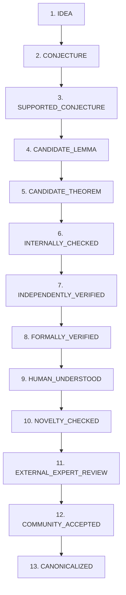

# MATHEMATICAL RESEARCH CONSTITUTION — v1.0
**Project:** Riemann Hypothesis Connes–van Suijlekom / Connes–Consani–Moscovici Positivity Investigation  
**Governing Standard:** Extension of Runtime Governance Kernel v2.10.0  
**Status:** Active Non-Negotiable Project Law  
**Adoption Date:** 2026-08-27  
**Last Reconciled:** 2026-08-28 (Protocol RH-MATHEMATICAL-RESEARCH-CONSTITUTION-001R1)

---

## 0. Preamble & Scope

This Constitution governs all AI-assisted and human mathematical research, theorem generation, lemma derivation, proof verification, novelty classification, and canonicalization for the Riemann Hypothesis research project. It extends existing experimental and empirical research memory into a self-correcting mathematical theorem-development system.

---

## 1. The Six Fundamental Laws of Mathematical Research

### I. The Truth Law
> **No mathematical claim may exceed its verified evidence.**
- Numerical verification, finite-dimensional matrix testing, and empirical bounds constitute heuristic support, never mathematical proof.
- An unproved hypothesis may never be treated as proved.
- `UNKNOWN`, `UNVERIFIED`, `OPEN`, `FALSE`, and `COUNTEREXAMPLE_FOUND` are valid and permanent epistemic statuses.

### II. The Identity Law
> **The problem identity, canonical statement, assumptions, domains, quantifiers, and conclusion may never drift silently during a proof attempt.**
- A proof that proves a weaker, modified, or parameter-restricted statement without an explicit governed reclassification is a **Proof Defect**, not a successful proof of the original target.

### III. The Independence Law
> **Discovery may not serve as its own final verifier.**
- Proof generation and proof verification must be executed by distinct agents/processes (`WRITER_ID != REVIEWER_ID`).
- Correlated LLM evaluations do not constitute independent verification. Every load-bearing step must survive adversarial counterexample search and source-level authentication.

### IV. The Understanding Law
> **A proof is not mature until its mathematical mechanism can be explained and defended by a responsible human mathematician.**
- A verified sequence of formal deductive steps without mechanistic understanding is classified as `VERIFIED_BUT_NOT_YET_UNDERSTOOD`.
- Every accepted theorem requires a 3-level explanation: (1) One-sentence core mechanism, (2) One-page proof architecture, (3) Complete rigorous formal proof.

### V. The Memory Law
> **Failures, counterexamples, proof bugs, abandoned pathways, and assumptions must remain permanently preserved and searchable.**
- Failed proofs are primary research assets. Every discovered mathematical flaw must be entered into the Proof Bug Regression Register with an active regression rule.

### VI. The Objective Law
> **The project optimizes for reliable, novel, explainable, and cumulative mathematical understanding — not the raw quantity of claims or proofs.**
- A smaller, fully understood, assumption-minimal theorem strictly outranks an over-parameterized, unverified mega-proof.

---

## 2. Mathematical Claim State Machine

Every mathematical proposition within the project progresses through an explicit **13-stage lifecycle**. **No stage may be skipped.**



### The 13 Enumerated States & Invariants:
1. `IDEA`: Informal mathematical concept or heuristic motivation.
2. `CONJECTURE`: Formally stated proposition with frozen quantifiers and domain.
3. `SUPPORTED_CONJECTURE`: Conjecture backed by numerical fixtures, toy models, or special-case calculations.
4. `CANDIDATE_LEMMA`: Fully written mathematical lemma proof draft submitted for verification.
5. `CANDIDATE_THEOREM`: Fully written comprehensive theorem proof draft submitted for verification.
6. `INTERNALLY_CHECKED`: Proof checked by writer against the Proof Bug Regression Register.
7. `INDEPENDENTLY_VERIFIED`: Blind-first proof audit completed by a distinct verifier with all lemmas authenticated.
8. `FORMALLY_VERIFIED`: Proof certified in an interactive theorem prover (e.g. Lean 4, Isabelle) with formalization fidelity verified.
9. `HUMAN_UNDERSTOOD`: 3-level understanding artifacts accepted; mechanistic explanation verified.
10. `NOVELTY_CHECKED`: Independent literature audit verifying prior art and establishing novelty status.
11. `EXTERNAL_EXPERT_REVIEW`: Pre-print review and adversarial critique by external domain experts.
12. `COMMUNITY_ACCEPTED`: Published and recognized in peer-reviewed mathematical literature.
13. `CANONICALIZED`: Assumption-minimized, generalized, and integrated into canonical mathematical knowledge.

*State Count Invariant:* `DECLARED_STATE_COUNT == ENUMERATED_STATE_COUNT == 13`.

---

## 3. Strict Separation of Result Dimensions

Every theorem candidate must be evaluated across three orthogonal dimensions. **Collapsing these dimensions is strictly forbidden.**

| Dimension | Description | Valid States |
|---|---|---|
| **Correctness** | Logical validity and rigor of the deductive chain | `UNCHECKED`, `INTERNALLY_CHECKED`, `VERIFIED`, `PROVED_CONDITIONAL`, `FALSE_OR_COUNTEREXAMPLE` |
| **Novelty** | Distinctness from existing published mathematical literature | `UNAUDITED`, `KNOWN`, `KNOWN_EQUIVALENT`, `KNOWN_STRONGER`, `POSSIBLY_NEW`, `AUTHENTICATED_NOVEL` |
| **Significance** | Depth, structural reach, and impact on target problems (e.g., RH) | `UNASSESSED`, `TECHNICAL_LEMMA`, `STRUCTURAL_BRIDGE`, `MAJOR_THEOREM`, `FOUNDATIONAL_BREAKTHROUGH` |

- *Rule:* A correct proof is not automatically novel. A novel lemma is not automatically significant.

---

## 4. Mandatory Preflight & Verification Gates

### A. The Adversarial Falsification Gate
Before allocating resources to a formal proof attempt, the candidate theorem must undergo an explicit adversarial falsification sweep:
1. Boundary cases and degeneracies (e.g., $\lambda \to 1^+$, $N=1$).
2. Symmetry-breaking perturbations.
3. Finite-dimensional toy operator projections.
4. Pathological non-local kernel constructions.
5. Semiclassical limit interchange tests.

### B. The Load-Bearing Lemma Register
Every proof must isolate its genuinely novel, load-bearing step. The proof cannot be presented as a single unstructured block. The load-bearing lemma must be analyzed for:
- What breaks without it.
- Known functional-analytic analogues.
- Why previous techniques failed to prove it.

### C. The Assumption Drift Monitor
Every assumption used in a deduction must be registered and classified:
- `ORIGINAL`: Part of the frozen problem definition.
- `DERIVED`: Rigorously deduced from original assumptions.
- `KNOWN_CONSEQUENCE`: Standard established property in the domain.
- `TEMPORARY`: Working hypothesis within a sub-lemma.
- `ADDITIONAL`: Newly added constraint narrowing the theorem scope.
- `UNJUSTIFIED`: Unproved assumption introduced without authorization (**BLOCKS PROMOTION**).

### D. The Formalization Fidelity Gate
When formal proof assistants (Lean, Coq, Isabelle) are utilized, a distinct audit must verify:
$$\mathcal{T}_{\text{Natural Language}} \stackrel{?}{\iff} \mathcal{T}_{\text{Formal}}$$
Checking that type classes, implicit coercions, function spaces, and boundary regularity match the intended mathematical proposition.

### E. Assumption Minimization & Alternative Proof Stages
Following independent verification of $A \wedge B \wedge C \implies T$:
1. **Minimization:** Attempt to eliminate hypotheses ($A \wedge B \implies T$). Classify each assumption as `ESSENTIAL`, `REMOVABLE`, or `PROOF_ARTIFACT`.
2. **Alternative Proofs:** Search for dual, geometric, or variational proof mechanisms to extract the invariant structural core.

---

## 5. Provenance, Tool, and AI Attribution Standard

Every consequential mathematical artifact must record its complete provenance block:
```yaml
provenance:
  model_id: "antigravity-gemini"
  orchestrator_id: "antigravity-local"
  timestamp_utc: "YYYY-MM-DDTHH:MM:SSZ"
  active_governance: "MATHEMATICAL_RESEARCH_CONSTITUTION_v1.0"
  tools_used: ["python_mpmath", "lean4", "literature_search"]
  reviewer_id: "independent-subagent"
  reviewer_independence: "HIGH (Distinct context / blind-first)"
  attempt_count: 1
```

---

## 6. Permanent Invariant
$$\boxed{\mathbf{NO\_RH\_PROOF = TRUE}}$$
Under no circumstances may any theorem, lemma, or convergence result in this project be construed as establishing a proof of the Riemann Hypothesis until certified by the global mathematical community.
